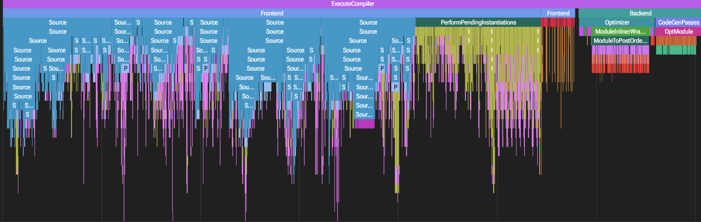
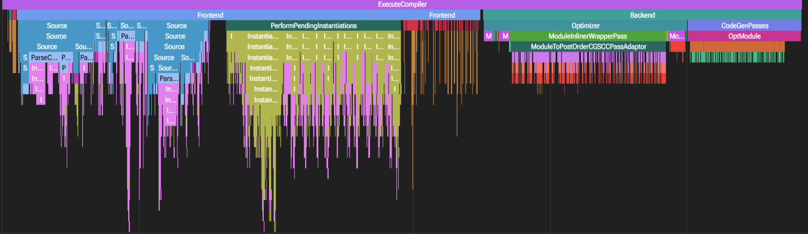

# Ускорение сборки C++-сервисов на открытом фреймворке userver

**Автор:** Котлечков Егор

**Репозиторий:** https://github.com/koterwk-cpu/userver-build-analysis

## Окружение и железо

- Хост: Windows + WSL; замеры внутри Docker-контейнера на образе ghcr.io/userver-framework/ubuntu-22.04-userver (Ubuntu 22.04.5 LTS, x86_64).
- Лимиты контейнера: `--cpus=4 --cpuset-cpus=0-3 --memory=8g --memory-swap=8g` (cgroup: cpu.max = 400000/100000, memory.max = 8 GiB).
- CPU: Intel Core i5-1235U (6 ядер / 12 потоков, L3 12 MiB); RAM хоста 7.6 GiB.
- Тип сборки Release; кэш ccache отключён (CCACHE_DISABLE=1); параллелизм -j4 по лимиту ядер контейнера.
- Инструменты: Clang 14.0.0, CMake 4.4.4, GNU Make 4.3, GNU ld 2.38; Clang Build Analyzer собран из исходников (aras-p/ClangBuildAnalyzer).

## Методика замеров

Базовый замер выполнен на шаблонном сервисе, созданном командой `userver-create-service --grpc --mongo --postgresql my_service` без изменения кода. Измерялась сборка с нуля. Флаг `-ftime-trace` передавался через `CMAKE_CXX_FLAGS`, компилятор записывал JSON-трейсы. Wall time и пиковая память фиксировались `/usr/bin/time -v`. Трейсы агрегировались с помощью Clang Build Analyzer, после чего строился текстовый отчёт. Отдельные трейсы просматривались в Perfetto.

## Выводы по базовому замеру

1. **Фронтенд занимает почти всё время.** Суммарное время компиляции по данным CBA — 38,1 секунды: фронтенд (Parsing) 31,2 секунды (82%), бэкенд (кодогенерация и оптимизации) 6,9 секунды (18%). Следовательно, оптимизировать в первую очередь нужно фронтенд.
2. **Время сконцентрировано в немногих файлах.** Десять самых тяжёлых парсятся суммарно 29,2 секунды — около 94% времени фронтенда. Самый долгий файл `main.cpp` — 5,8 секунды.
3. **Повторный парсинг тяжёлых заголовков.** В разделе expensive headers несколько тяжёлых заголовков включаются повторно: `hello_service.usrv.pb.hpp` 4771 мс (3 включения), `hello_postgres.hpp` 3632 мс (2), `component.hpp` 3133 мс (4), `hello_grpc.hpp` 3012 мс (2), `hello.pb.h` 2740 мс (6), `fmt/format.h` 2056 мс (10).

{width=90%}

## Гипотеза

Если предкомпилировать несколько тяжёлых заголовков, которые включаются несколько раз (Precompiled Headers, PCH), то время фронтенда уменьшится.

## Эксперимент

В CMakeLists.txt в `target_precompile_headers` (цели `my_service` и `my_service_objs`) добавлены выбранные заголовки, которые компилируются долго и включаются несколько раз: `hello_service.usrv.pb.hpp` (4771 мс, 3 включения), `hello_postgres.hpp` (3632 мс, 2), `component.hpp` (3133 мс, 4), `hello_grpc.hpp` (3012 мс, 2), `fmt/format.h` (2056 мс, 10). Сборка выполнена с нуля в отдельной директории с флагом `-DENABLE_PCH=ON`. Остальные флаги такие же.

## Результаты и проверка гипотезы

На отдельных файлах PCH дал ускорение:

| Файл | Baseline, мс | С PCH, мс | Экономия, мс |
|---|---|---|---|
| main.cpp | 5789 | 1692 | 4097 |
| hello_postgres.cpp | 2962 | <622* | ≥2340 |
| hello_grpc.cpp | 2354 | <622* | ≥1732 |
| hello_mongo.cpp | 2152 | 622 | 1530 |
| hello.cpp | 1879 | <622* | ≥1257 |
| **Сумма** | | | **≥11,0 с** |

\* Файл ускорился настолько, что выпал из топ-10 отчёта PCH (последняя строка — 622 мс).

Однако суммарное время компиляции не уменьшилось: сборка с PCH составила 38,4 секунды (фронтенд 30,8 секунды, бэкенд 7,6 секунды), в то время как в baseline — 38,1 секунды (31,2 секунды / 6,9 секунды). Разница +0,3 секунды очень мала, на уровне погрешности. Wall time при этом вырос с 38,25 до 42,42 секунды (+10,9%). Пиковая память не поменялась: ≈1,23 ГиБ у обеих сборок (1293196 и 1293476 КиБ, разница +280 КиБ в пределах шума).

Суммарный эффект близок к нулю по CBA, потому что экономия на пяти покрытых файлах компенсирована компиляцией самого PCH для двух целей — 5,0 секунды для `my_service` и 3,1 секунды для `my_service_objs`, суммарно +8,1 секунды дополнительных затрат, а непокрытая цель `my_service_proto` (12,4 секунды парсинга) замедлилась до 15,1 секунды (+2,7 с, +22%). Получается, фронтенд −0,4 с, CBA total +0,3 с, wall time +4,2 с.

Видно, что в файле main.cpp время парсинга уменьшилось: по трейсу Perfetto 7,07 стало 2,92 с (−59%), по CBA 5789 стало 1692 мс (−71%). После PCH вклад Source уменьшился.

{width=90%}

## Что не получилось и почему

Прекомпиляция заголовков заняла примерно столько же времени, сколько должна была сэкономить, поэтому суммарный эффект по времени компиляции (CBA) оказался близок к нулю. Из-за погрешности измерений и малой разницы в цифрах нельзя однозначно утверждать, стало ли время компиляции лучше, однако wall time сборки вырос на 11% (с 38,25 до 42,42 с).

---
*Сырые данные в репозитории: `results/baseline_cba.txt`, `results/pch_cba.txt`, `results/*_time.txt`, `results/environment.txt`, трейсы Perfetto `results/main_trace_*.json`.*